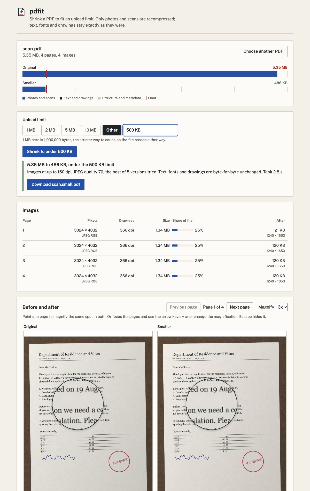

# pdfit

Shrinks a PDF until it fits an upload limit, like the "max 2 MB" on a visa portal or a job application, by
recompressing only the photos and scans inside it. Text, fonts and line drawings come out byte for byte the same, so
nothing gets blurry except pictures that were bigger than they needed to be. It runs on your computer; the file never
goes anywhere.



## Run it

You need Rust 1.88 or newer. The web page also needs Node 22 and pnpm to build.

```sh
cargo build --release
./target/release/pdfit scan.pdf                 # list the images and what they weigh, write nothing
./target/release/pdfit scan.pdf --under 1MB     # writes scan.small.pdf next to it
./target/release/pdfit scan.pdf --under 500KB -o upload.pdf --json
```

```
$ pdfit scan.pdf
scan.pdf: 5.35 MB, 4 pages, 4 images taking 5.35 MB (100% of the file).
  page 1       3024 x 4032  JPEG   RGB    366 dpi   1.34 MB
  ...
$ pdfit scan.pdf --under 1MB
scan.pdf: 5.35 MB, 4 images.
Made 5 versions; the best one that fits is 200 dpi at JPEG quality 80.
Wrote scan.small.pdf: 966 KB (82% smaller) in 2.0 s.
Text, fonts and drawings are byte-for-byte unchanged.
Recompressed:
  page 1       3024 x 4032  JPEG   RGB    366 dpi   1.34 MB  -> 1653 x 2204, 242 KB
  ...
```

The exit code is 0 when the result fits, 2 when it doesn't (the smallest version is still written, and pdfit says
why), and 1 on an error. MB means 1,000,000 bytes, the stricter reading, so the file passes whichever way a site counts.
The input is never changed, and pdfit refuses an output path that points at it.

The web version:

```sh
cd web && pnpm install && pnpm build && cd ..
cargo build --release --features web
./target/release/pdfit-web                       # then open http://127.0.0.1:7474
./target/release/pdfit-web scan.pdf --under 1MB  # or start with a file open and shrunk
```

Drop a PDF, pick 1, 2, 5 or 10 MB or type a size, and press the button. The page shows where the bytes go as a bar with
the limit drawn through it, lists every image with its pixel size, the dpi it's drawn at and its share of the file,
and puts the original and the smaller pages side by side. Point at either page, or focus it and use the arrow keys, to
magnify the same spot in both. The UI is built into the binary, and the server listens on 127.0.0.1 only.

## Measured

Every number below comes from `scripts/measure.py`, which runs the release build three times per case and keeps the
median time, then checks the output. The raw results are in `fixtures/results.json`. Machine: Apple M4, 16 GB,
macOS 26.6.2, rustc 1.98.0.

The fixtures are generated by `scripts/make_fixtures.py` (seeded, about 36 MB, not checked in): phone photos of a
letter, a grey scan stored as Flate with a PNG predictor, a report with embedded fonts and photos, a form with a
signature that has a soft mask, a CMYK JPEG with an inverted Decode array, a large image with a soft edge, a file whose
embedded Korean font alone is 7 MB, and an AES-256 encrypted file.

| File | Limit | Before | After | Setting chosen | Time | Min PSNR | Min SSIM |
| --- | --- | --- | --- | --- | --- | --- | --- |
| scan.pdf | 2 MB | 5.35 MB | 1.40 MB | 250 dpi, q80 | 4.34 s | 44.6 dB | 0.990 |
| scan.pdf | 1 MB | 5.35 MB | 966 KB | 200 dpi, q80 | 3.25 s | 43.3 dB | 0.987 |
| scan.pdf | 500 KB | 5.35 MB | 486 KB | 150 dpi, q70 | 1.53 s | 37.9 dB | 0.980 |
| scan-gray-png.pdf | 2 MB | 5.30 MB | 1.50 MB | 300 dpi, q85 | 0.94 s | 52.1 dB | 0.995 |
| scan-gray-png.pdf | 1 MB | 5.30 MB | 760 KB | 250 dpi, q80 | 1.10 s | 49.5 dB | 0.993 |
| report.pdf | 2 MB | 2.66 MB | 1.25 MB | 300 dpi, q85 | 1.23 s | 46.3 dB | 0.993 |
| report.pdf | 1 MB | 2.66 MB | 970 KB | 250 dpi, q80 | 1.25 s | 44.6 dB | 0.991 |
| report.pdf | 500 KB | 2.66 MB | 2.64 MB | doesn't fit | 0.09 s | | |
| form-signature.pdf | 500 KB | 838 KB | 495 KB | 300 dpi, q85 | 0.28 s | 43.6 dB | 0.995 |
| form-signature.pdf | 300 KB | 838 KB | 828 KB | doesn't fit | 0.03 s | | |
| cmyk.pdf | 1 MB | 3.19 MB | 690 KB | 300 dpi, q85 | 1.00 s | 46.8 dB | 0.992 |
| smask.pdf | 1 MB | 8.74 MB | 817 KB | 300 dpi, q85 | 1.30 s | 47.9 dB | 0.997 |
| fonts-heavy.pdf | 2 MB | 7.24 MB | 7.24 MB | doesn't fit | 0.17 s | | |
| encrypted.pdf | 2 MB | 2.67 MB | refused | | 0.01 s | | |

How to read it:

- PSNR and SSIM compare each image's area on the page, rendered at 150 dpi by mupdf, against the same area of the
  original. They are the worst image in the file, not an average. SSIM is on luma with a 7 x 7 window.
- Every output passed qpdf's syntax check (through pikepdf) and rendered in mupdf with no warnings, and the text mupdf
  extracts from each page is identical to the original's.
- Timings vary with what else the machine is doing: the scan.pdf 2 MB case measured 3.29 s and 4.34 s in two runs on the
  same afternoon. Most of the time goes to decoding and Lanczos-resizing 12-megapixel JPEGs.
- The three "doesn't fit" cases are fonts and text that are already over the limit on their own. pdfit leaves the
  images alone there instead of ruining them for nothing, and says so: "The text and fonts alone are 602 KB, more than
  the 500 KB limit, and pdfit never changes those, so it left the images as they were."

## How it works

1. **Read.** lopdf loads the file. Encrypted files are refused with a message, because a rewritten copy would lose its
   protection. So are files without a PDF header or without pages.
2. **Find the images.** pdfit walks each page's content stream, following `q`/`Q`/`cm` to track the transformation
   matrix and descending into Form XObjects (with cycle and depth guards) and annotation appearances. For every image
   it records the largest size it's drawn at, which gives its effective dpi. An image used on several pages is
   rewritten once, sized for its largest use.
3. **Tidy, losslessly.** Page thumbnails are dropped, identical streams are merged, unreferenced objects are removed,
   uncompressed streams are Flate-compressed, and the file is written with object streams. If that alone fits, no
   image is touched.
4. **Try settings.** A ladder of nine (dpi, JPEG quality) pairs runs from 300 dpi at quality 85 down to 72 dpi at
   quality 40. pdfit first checks the bottom rung, then binary searches for the gentlest rung that fits. Images are
   decoded (JPEG through jpeg-decoder, Flate with all PNG and TIFF predictors through pdfit's own code), downsampled
   with Lanczos3 when they're more than about 10% above the target dpi, and re-encoded as JPEG. A recompressed image is kept
   only if it's at least 5% smaller than what was there.
5. **Check.** The result is re-parsed, and every page's decoded content streams, forms and font programs are compared
   with the original. Any difference is an error, not a warning.

Colour details that matter:

- CMYK JPEGs stay CMYK with their original colour space and Decode array. Converting to RGB scored 23.6 dB PSNR on the
  test file; keeping CMYK scores 46.8 dB and makes a smaller file. Adobe's inverted CMYK JPEGs are handled.
- Images with a soft mask are resized premultiplied by the mask, so fully transparent pixels (often black) don't bleed
  into the edges. A blue signature stays blue at 72 dpi instead of turning grey. The mask is resized to match.
- Gray, RGB, CMYK and ICCBased spaces with 1, 3 or 4 components are recompressed. Indexed images, 1-bit images, stencil
  masks, colour-key masks, 16-bit samples, JBIG2, CCITT and JPEG 2000 are left as they are, and the image list says
  which and why. Inline images inside content streams are never changed. Images under 16 KB aren't worth touching.

## Limits

- pdfit only shrinks images. A file that's mostly fonts (CJK fonts are often several MB) or vector drawings can't be
  brought under a limit smaller than those parts, and pdfit tells you that rather than producing a broken result.
- Fonts are never subset or removed, even when only a few glyphs are used. That would save the most on fonts-heavy
  files, but it is exactly the kind of change that can break text.
- JBIG2, CCITT and JPEG 2000 images are left alone, since there's no pure-Rust encoder for them that pdfit trusts.
  Scans stored that way are usually small already.
- The ladder never goes below 72 dpi. At that point small print in a scan is already hard to read.
- The web server keeps one file in memory at a time and is meant for one person on their own machine.
- The fixtures are synthetic. They cover the structures listed above, but real PDFs from odd producers will find
  cases these don't.

## Development

```sh
cargo test --features web
cargo clippy --all-targets --features web -- -D warnings
cd web && pnpm test && pnpm build

# fixtures and measurements (needs: pip install pymupdf pikepdf pillow numpy)
python3 scripts/make_fixtures.py
cargo build --release && python3 scripts/measure.py
```

In development, run `pnpm dev` in `web/` with `pdfit-web` running; Vite proxies `/api` to port 7474. Or pass
`--static-dir web/dist` to serve a fresh build without recompiling the binary.
